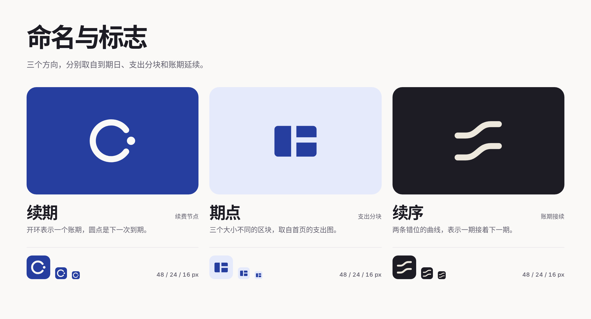

Lead: 「续期」是工作名。产品以手机竖屏为主，集中展示订阅支出、近期扣费和手动续费。用户可按服务搜索套餐，带入 Logo 和参考价，改成自己的账单金额后保存。

## A 首版范围

| 功能 | 首版范围 |
| --- | --- |
| 订阅账本 | 每人独立账本，可增改查、搜索、暂停、恢复和结束。软件会员、VPS、电话卡和固定账单共用表单。 |
| 支出概览 | 月均订阅支出、支出构成、近期续费。计划金额和已付金额分别展示。 |
| 日历与记录 | 按日期看近期扣款与到期。支持确认付款、查看和更正历史。 |
| 订阅目录 | 搜索服务并选择地区、套餐和周期。预填 Logo、币种与参考价，支持手动添加。 |
| 扣费渠道 | 每个用户可新增、改名、停用和重新启用自己的渠道。 |
| 账本迁移 | 每个用户可导出和导入自己的 JSON 账本。 |

首版建议支持少量受邀用户。前端单独部署，后端以 API 提供数据。订阅通知、银行账单接入、实际扣款、共享账本和统一汇率汇总放到后续评估。

## B 竖屏前端

| 页面 | 布局与操作 |
| --- | --- |
| 首页 | 顶部是新增入口和月均订阅支出，中间是支出图，底部按日期列近期续费。扣款方式和渠道跟在日期及金额旁。 |
| 订阅 | 列表按名称搜索，可按状态和分类筛选。条目优先给服务商 Logo、金额、周期和下次扣费日。 |
| 日历 | 月历用服务商 Logo 标示有账单的日期。点某天下方展开账单，大屏可并排显示。 |
| 新增、编辑 | 复用表单。手机全屏，桌面可放侧栏。选择目录套餐后，名称、金额、币种和周期仍可直接改。 |
| 详情 | 头部显示品牌、金额、周期、下次应付日、续费方式和渠道。下方是付款记录、编辑和管理入口。 |
| 设置 | 管理默认地区、币种、时区、首页图表和账本备份。提供单独的扣费渠道入口。 |
| 扣费渠道 | 用品牌 Logo 区分预设渠道。右上角新增，点一行改名、停用或重新启用。 |

**两版首页**共用数据。泡泡版以圆面积映射月费，做轻微漂移。分块版在同一个大矩形内按月费分配区块面积。两版都能点选图形查看对应金额与占比。图下只在选中时显示明细，跟随系统减少动态效果设置。

**视觉**沿用暖白 `#FAF9F7`、墨色 `#1D1C24` 和钴蓝 `#263E9F`。订阅品牌优先采用原色 Logo。月均总额使用 Allo Variable，分别排货币符号、整数和小数。中文使用系统中文字体。

金额、日期和扣费渠道优先于装饰图形。窄屏的小区块优先放 Logo，金额可点开读。常规编辑直接保存，暂停和结束用明确的动作标签。

[Doop 竖屏原型与品牌探索](https://doop.design/c/Kz6WDDMdvN) · [Allo](https://allo.joshpuckett.me/)

## C 录入、账期与统计

```flow
搜索品牌 -> 选地区与套餐: 有匹配预设
搜索品牌 -> 填写表单: 自定义或只有品牌
选地区与套餐 -> 填写表单: 预填 Logo 和报价
填写表单 -> 保存订阅
保存订阅 -> 续费日历
续费日历 -> 确认付款
确认付款 -> 已付统计
```

- **常用字段**包括名称、金额与币种、周期、下次应付日、续费方式和扣费渠道。新建默认月付，渠道可留空。分类、管理链接、备注及截止日期放在更多选项。
- **续费方式**有自动扣款与手动续费。官网、App Store 属于销售平台，用于查找套餐。
- **扣费渠道**预设微信支付、支付宝 Alipay、Apple Pay 和 Mastercard。新增和编辑订阅共用渠道列表。停用的渠道从新选项中移除，已有订阅继续显示原关联。已确认的付款保留当时记录的渠道名称。
- **账期**支持一次性和每 N 天、周、月、年。日期按用户时区解释。按月和按年保留账期锚点，1 月 31 日的月付在 2 月落到月底，3 月回到 31 日。
- **自动扣款**按日历向后预测。手动续费到期时保留待处理项。确认续费后，默认从原到期日推进，可按实际续费规则改日期。
- **状态**用生效中、暂停和已结束。取消时可填实际服务结束日。试用有首次收费日时，首笔待付款出现在日历。月均图只统计已进入付费周期且生效中的周期订阅。
- **实际支出**只计入已确认的付款。付款记录保存实际日期、金额和币种。改订阅金额只重算未来。相同订阅和账期的重复提交指向同一付款记录。
- **计划支出**提供月均以及未来 30 天和 12 个月的应付金额。每 N 年费用除以 `12 × N`，每 N 月费用除以 N。每 N 天或周按一年 365 天折月。计算后再做展示精度舍入。多币种按原币分开汇总，首页切换当前展示币种。

## D 后端与数据

```flow
独立前端 -> Axum JSON API: 订阅、日历与目录
脚本与快捷指令 -> Axum JSON API: 读写令牌
Axum JSON API -> [(SQLite)]
公开价格源 -> 进程内同步任务
进程内同步任务 -> [(SQLite)]: 合并目录
```

后端用 Rust、Axum 和 SQLite。建议用 SQLx 管理查询和迁移。API 和价格同步共用一个进程。前端可独立构建，用同一域名反向代理 `/api`。

| 数据表 | 主要内容 |
| --- | --- |
| `users` | 昵称、时区、默认地区与币种、令牌摘要。 |
| `billing_channels` | 用户、渠道名称、可选品牌标识、启用状态。 |
| `subscriptions` | 用户、可选品牌关联、名称、周期、账期锚点、金额、币种、续费方式、可选渠道 ID 和状态。 |
| `payment_records` | 订阅、账期日期、实付时间、金额、币种及当时的渠道名称。订阅和账期组成唯一键。 |
| `catalog_services` | 服务名称、搜索别名、官网域名和 Logo。目录为实例内所有用户共享。 |
| `catalog_prices` | 服务、地区、平台、套餐、扣费周期、原币金额、来源和核验时间。抓取时间单独记录。 |

入账金额以币种最小单位的整数存储，并按币种精度解析。用户订阅存自己的金额和周期，即使对应目录条目改价或下架，也可继续记账。

## E API 与访问

所有接口以 `/api/v1` 为前缀。管理员通过 CLI 建用户和轮换令牌。每人一个随机读写令牌，前端和脚本用 `Authorization: Bearer <token>` 访问。

| 方法与路径 | 用途 |
| --- | --- |
| `GET /overview?currency=…` | 当前币种的月均支出、支出构成、近期续费、本月已付和未来应付。 |
| `GET /calendar?from=…&to=…` | 指定日期区间内的账期、付款及截止事项。 |
| `GET /subscriptions`、`POST /subscriptions` | 按名称、状态、分类查找，或新增订阅。 |
| `GET/PATCH/DELETE /subscriptions/{id}` | 详情、编辑、变更状态与删除误建记录。 |
| `GET/POST /subscriptions/{id}/payments` | 查付款记录和确认付款。用 `PATCH /subscriptions/{id}/payments/{payment_id}` 更正。 |
| `GET/POST /billing-channels`、`PATCH /billing-channels/{id}` | 列出、新增、改名、停用和启用当前用户的渠道。 |
| `GET /catalog/services?q=…` | 搜索品牌及别名，返回 Logo 和服务标识。 |
| `GET /catalog/services/{id}/prices?region=…` | 获取指定地区的套餐候选、币种、周期和参考价格。 |
| `GET/PATCH /me`、`GET /export`、`POST /import` | 账户偏好、备份导出和导入。导入可先预览结果。 |

用户归属由后端从令牌识别。读写与统计均限定当前用户。数据库只存令牌摘要，传输使用 HTTPS。首版可由用户粘贴令牌进入前端，页面内存持有令牌。

## F 目录更新与断网

| 情况 | 首版行为 |
| --- | --- |
| 首次部署 | 导入一份可用的本地目录快照，按服务商域名关联 Logo。 |
| 搜索 | 前端请求自己的 Axum，Axum 查 SQLite。常用地区默认选中，可手动切换。 |
| 定期同步 | 建议每天同步一次。以 OpenTheRank CSV 做底表，官网补常用地区、套餐和年度预付。其他数据源作为补充。 |
| 合并报价 | 用地区、平台、套餐和周期匹配。以有效来源和核验日期比较报价。完整通过校验后，在事务中提交更新。 |
| 上游超时或限流 | 继续用已有 SQLite 目录和最近一次可用报价。没有对应价格时，先带入名称与 Logo，金额保留为空。 |
| 已选服务要查新价 | 可后加短时在线刷新。发现缺价或缓存超过刷新间隔时再查询。超时回退本地。 |

记录目录来源及核验日期。只有真实年付或预付报价才带入对应周期。发布目录时保留各来源要求的署名。需要断网时也展示的 Logo，随目录保留可本地托管的版本。

这套缓存覆盖后端连不上上游。手机连不上自托管后端时，离线搜索需要在手机上另存目录，可后续加入。

[目录调研](订阅预设目录调研.html) · [在线查询与缓存](订阅目录在线查询与缓存.html)

## G 实现顺序与验收

| 阶段 | 验收场景 |
| --- | --- |
| API 与账期 | 两个账户各自 CRUD。1 月 31 日的月付跨月正确。重复确认同一账期，只保留一条付款。 |
| 竖屏与录入 | 两版图用相同金额和订阅数据。能点到明细。总额及扣费渠道在手机上易读。 |
| 目录与回退 | 搜索 Spotify 后选地区和套餐，改价保存。模拟上游超时，已有预设仍可用，已保存金额保持用户值。 |
| 渠道与备份 | 自定义渠道可用于订阅录入。停用后已有订阅与付款历史仍可查看。备份包含渠道及关联，支持预览导入。 |

部署以独立 Web 静态站和一个 Axum 进程为单位。SQLite 文件放持久卷。备份使用 SQLite 在线备份接口。

## H 产品命名与标志

| 名字 | 含义 | 标志构思 |
| --- | --- | --- |
| **续期** | 看到名字就知道与订阅到期有关。可沿用现有原型字标。 | **续费节点**。钴蓝面上的暖白开环表示一个账期，缺口的圆点表示下一次到期。延续原型字标旁的小蓝点。 |
| **期点** | 取账期和时间点，适合强调每笔续费何时发生。 | **支出分块**。三个不等的方块来自支出图，缩小后也能保留轮廓。 |
| **续序** | 有按顺序整理、一期接一期的含义。 | **账期接续**。墨色底上，两条曲线以同样的弧度向前延伸。 |
| **订阅簿** | 像一本只记订阅的账簿，功能指向最清楚。 | 可搭配分块图形，作为字面更直接的名字。 |

推荐先用 **续期 + 续费节点**。它延续首页原有的小蓝点，也能独立用作浏览器图标。三个主方向均已放入 Doop 的「品牌探索 · 命名与 Logo」，附 48、24、16 像素样式。



名字和图形都是候选，尚未做同名排查。首发地区、首页默认图表、前端框架和正式名称待定。

## I 后端首版实现

后端代码位于仓库的 `backend/`，当前使用 Axum 0.8、SQLx 0.9 和 SQLite。已经落地用户令牌认证、用户偏好、扣费渠道、订阅 CRUD、付款记录、概览、续费日历、目录查询接口和 JSON 导入导出。数据库迁移包含用户账本、目录服务、目录报价和付款记录表。

服务通过 CLI 创建用户和轮换 token。创建用户时会初始化微信支付、支付宝 Alipay、Apple Pay 和 Mastercard 四个扣费渠道。token 只在命令行创建或轮换时展示，数据库保存 SHA-256 摘要。

目录价格同步任务尚未接入具体上游，当前后端已经保留目录表和读取接口。后续接入同步任务时，目录报价仍只作为录入参考，不会覆盖用户已经保存的实际金额。
